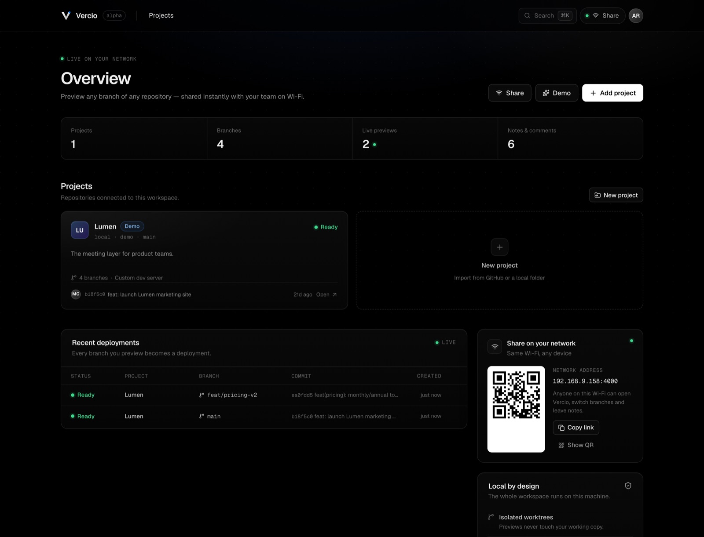
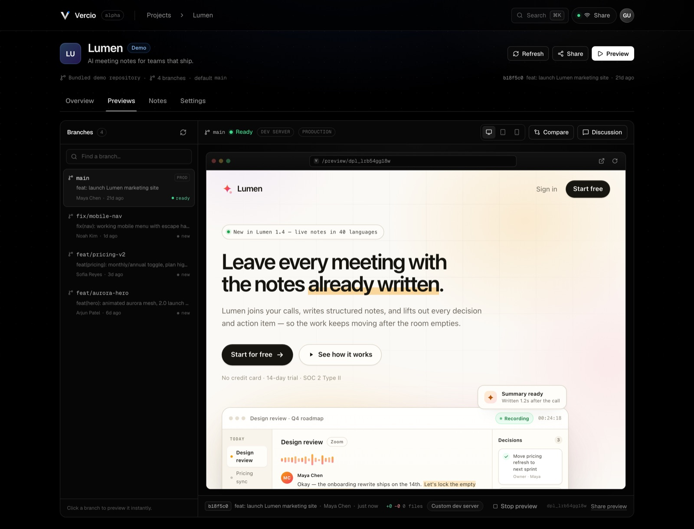
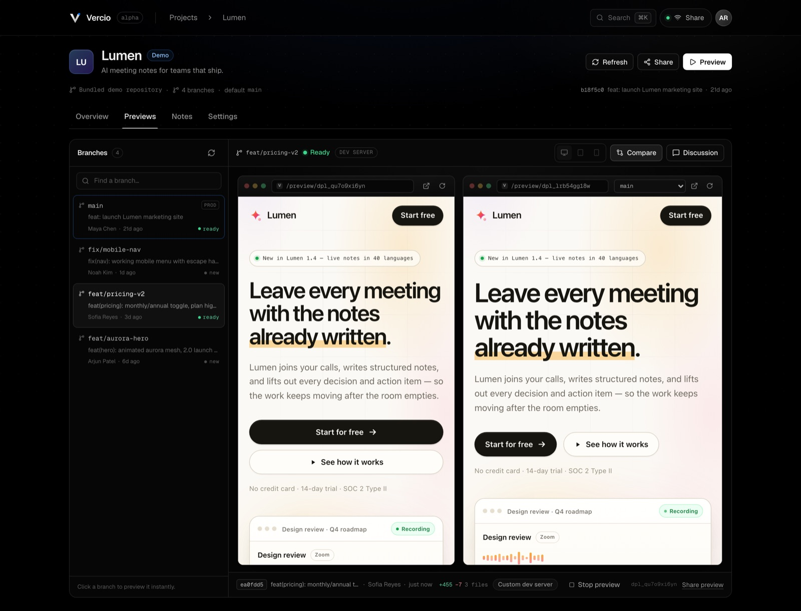
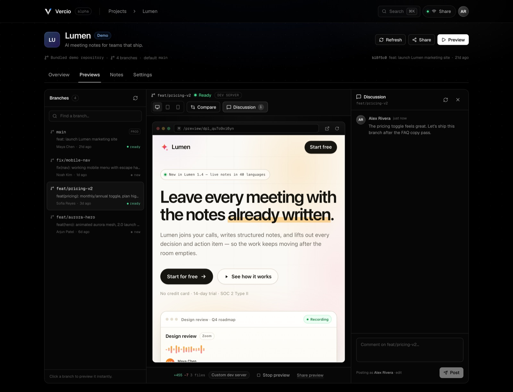
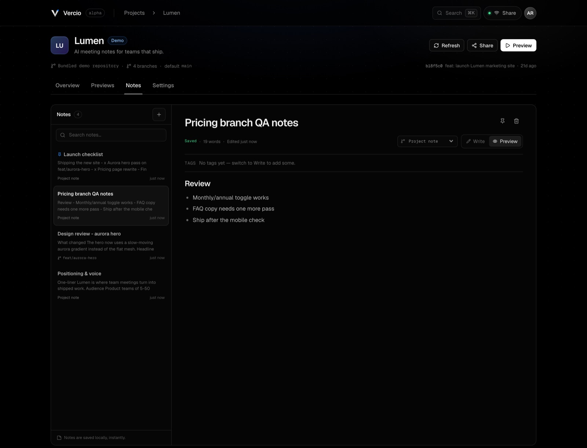
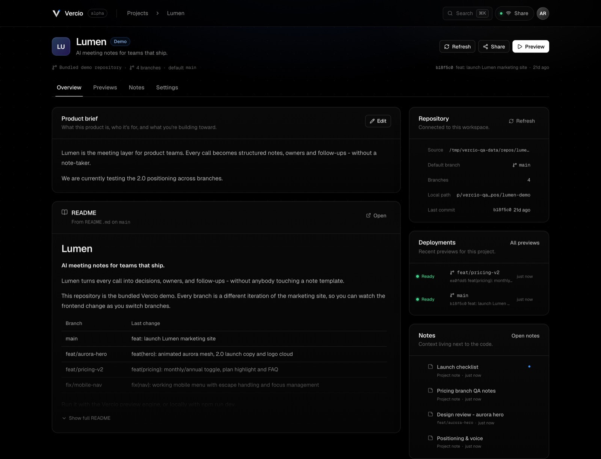
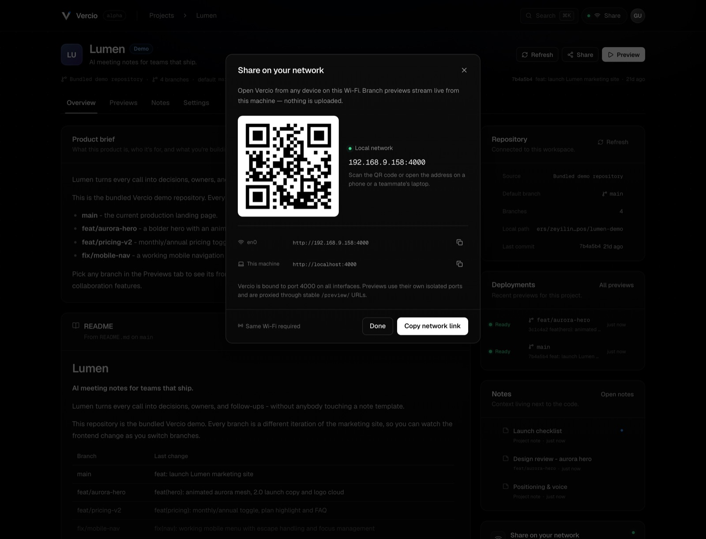
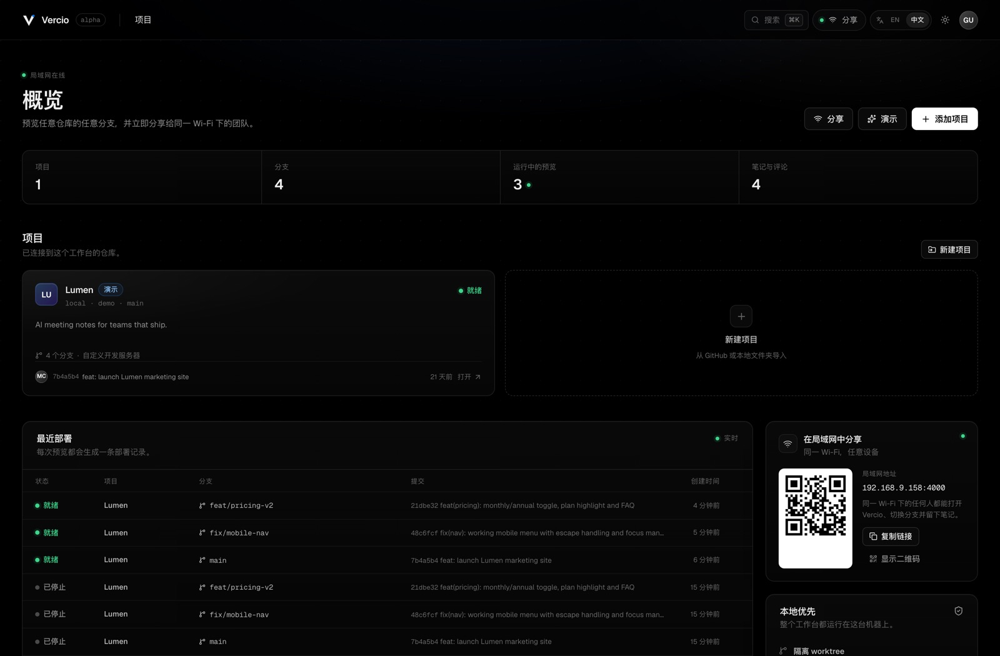
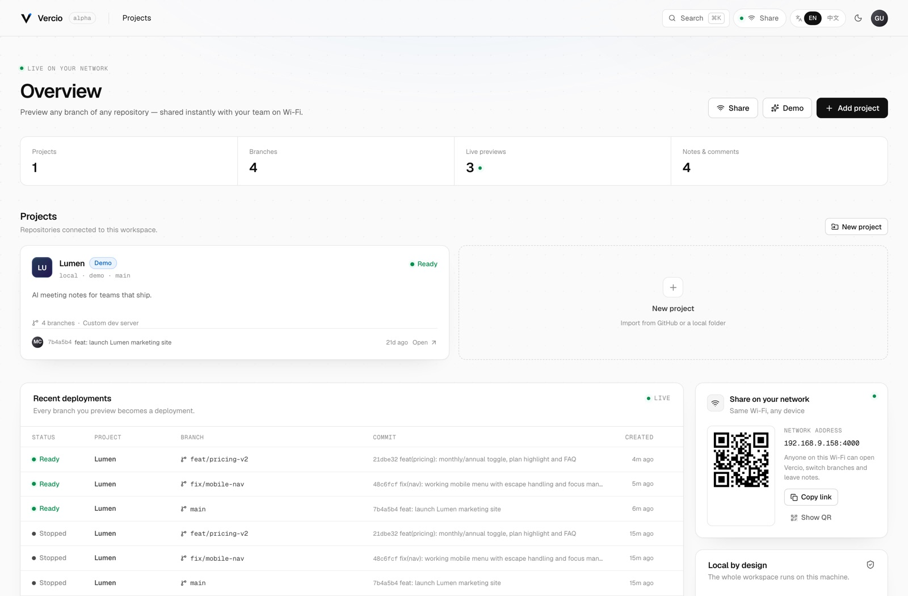
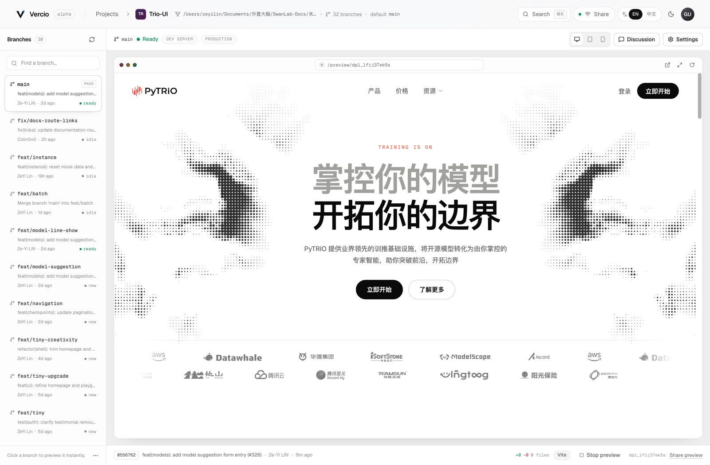

# Vercio

[中文](README.md) | **English**

> A local-first, Vercel-style frontend collaboration layer: point Vercio at a Git repository, click any branch in the browser, and see its frontend change live — then share it with everyone on your Wi-Fi.

Vercel's frontend collaboration used to mean connecting a GitHub repo to the cloud and previewing the latest branch online. Vercio brings that loop back to your machine: the repository stays local, each branch is checked out into an isolated Git worktree and served as a live preview. Switch branches with one click, compare two branches side by side, and invite teammates on the same network by QR code.

## Highlights

- **Branch previews, not builds** — any GitHub or local Git repository; every branch becomes a live preview. Repeat visits are instant because worktrees, dependencies and deployment records are reused.
- **Side-by-side compare** — pick any two branches and compare their frontends, with file and line-change counts against production.
- **LAN sharing** — Vercio binds to `0.0.0.0:4000` by default. Scan the QR code and teammates can open the same workspace. Every preview has a stable `/preview/<id>` URL that can be shared on its own.
- **Product workspace** — editable product brief, rendered README, Markdown notes with tags, pinning, autosave and branch linking, and per-branch discussions.
- **Framework detection** — Next.js, Vite, Astro, SvelteKit, Remix, Nuxt, CRA, Vue CLI, Gatsby, custom dev servers and static sites get the right port and host flags automatically.
- **Dependency caching** — cache `node_modules` by `package.json` + lockfile fingerprint; reuse the working copy's dependencies when they match.
- **System folder picker** — Browse opens the operating system's own folder chooser (macOS, Windows, Linux) and fills the selected repository path in for you; when no GUI is available it falls back to an in-page browser.
- **Visible progress** — live logs for worktree preparation, dependency install and dev-server startup; retry after failures, stop previews on demand.
- **Local-first** — code, branches, product briefs, notes and comments live in `.vercio/` on this machine. Nothing is uploaded.
- **Chinese / English UI** — auto-detects the browser language and can be switched with the **EN / 中文** control in the top bar. Project content stays in its original language.
- **Light / dark themes** — follows the system appearance on first visit and can be toggled with the sun/moon button in the top bar (or from the local profile dialog). The preference is remembered. The **full-width layout** uses the whole screen so wide previews and deployment tables stay comfortable on large monitors.

## Screenshots

| Branch preview | Side-by-side compare |
| --- | --- |
|  |  |

| Discussion | Notes |
| --- | --- |
|  |  |

| Overview (brief + README) | Share on Wi-Fi |
| --- | --- |
|  |  |

| Chinese UI (dark) | English UI (dark) |
| --- | --- |
|  |  |

| Light mode · dashboard | Light mode · branch preview |
| --- | --- |
|  |  |

## Quick start

Requirements: **Node.js `^20.19.0 || >=22.12.0`** and **Git**. macOS and Linux are supported (Windows is untested).

~~~bash
npm install

# Development: Vite frontend (default 5173) + API on 4000
npm run dev

# Production: build the frontend, then let the Node server host it
npm run build
npm start
~~~

Open http://localhost:4000. Then:

1. Click **Load demo project** to load the bundled four-branch Lumen demo (branch switching, compare, notes and discussion are all seeded), or
2. Click **Add project** and enter a GitHub repository (`owner/repo` or a full URL) or an absolute local repository path.

LAN sharing: click **Share** in the top bar or use the QR code on the dashboard. Vercio listens on `0.0.0.0:4000` by default; any device on the same Wi-Fi can open `http://<your-LAN-IP>:4000`.

Other useful commands:

~~~bash
npm run demo        # prepare the demo project in .vercio/ without starting the UI
npm run start:open  # start and open the browser
npm test            # backend integration tests
npm run typecheck   # TypeScript checks
~~~

## Technical docs

Code-level documentation for contributors and AI coding agents lives in [docs/](docs/README.md): architecture and the preview pipeline, server/frontend internals, the API contract, data model, development and debugging, plus an [AI coding guide](docs/ai-coding.md). AI agents can start from [AGENTS.md](AGENTS.md).

## Usage

1. **Add a project** — GitHub repositories are cloned into `.vercio/repos/`; local repositories are referenced in place and your working copy is never modified.
2. **Previews** — click a branch in the left panel. If that branch is not running yet, Vercio asks before starting a local dev server; the first start creates an isolated worktree, installs dependencies and streams logs. Repeat visits reuse the running preview. Use the expand button in the browser chrome for a fullscreen, chrome-free preview (Esc exits).
3. **Compare** — click **Compare**, choose another branch on the right, and inspect two live frontends side by side.
4. **Discussion** — open **Discussion** on a preview to leave branch-specific feedback. Everyone on the network sees it instantly.
5. **Brief and notes** — write the product brief on the Overview tab and keep design reviews, launch checklists and open questions in Notes. Markdown, autosave and tags included.
6. **Share** — the top-bar Share dialog shows a QR code and LAN URLs; individual `/preview/<deployment-id>/` links can be shared too.

## Supported frameworks

| Type | Detection | Command |
| --- | --- | --- |
| Next.js | `next` dependency | `npm run dev -- -p PORT -H 0.0.0.0` |
| Vite (React/Vue/Svelte/Remix, etc.) | `vite` dependency or `vite.config.*` | `npm run dev -- --port PORT --host 0.0.0.0 --strictPort` |
| Astro | `astro` dependency | Vite port flags |
| SvelteKit | `@sveltejs/kit` dependency | Vite port flags |
| Nuxt | `nuxt` dependency | `npm run dev -- --port PORT --host 0.0.0.0` |
| Create React App | `react-scripts` dependency | `PORT` / `HOST` env |
| Vue CLI | `@vue/cli-service` dependency | `PORT` env |
| Gatsby | `gatsby` dependency | `gatsby develop -p PORT -H 0.0.0.0` |
| Custom dev server | `package.json` has a `dev` / `start` script | `PORT` / `HOST` env; read them in your server |
| Static site | `index.html` at root or in dist/build/out/public | Built-in static server, no build needed |

Package managers are detected from lockfiles: pnpm, yarn, bun or npm.

> Custom dev servers must read `PORT` (or accept `--port`) and bind to `0.0.0.0`, otherwise LAN previews and readiness checks cannot work.

## How it works

- **Isolated worktrees** — each `(project, branch, commit)` maps to a `git worktree` under `.vercio/worktrees/<projectId>/<branch>-<sha>`. Branches never collide with each other or with your working copy.
- **Port allocation** — previews use free ports in `4100–4999` and bind to `0.0.0.0`. Up to 8 previews stay alive; the oldest is stopped when the limit is exceeded.
- **Stable preview URLs** — iframes load `/preview/<deploymentId>/`, which redirects to the right port. Absolute asset paths, Vite HMR and built static output all keep working, and LAN devices automatically get redirects based on their own hostname.
- **Dependency cache** — hashes `package.json` + lockfile and caches `node_modules` under `.vercio/deps/<projectId>/<hash>/`. If the project working copy already has matching dependencies, that folder is reused.
- **Save-to-preview** — previewing the checked-out branch mirrors your uncommitted changes (modified/added/deleted/renamed files and `.env*`) into the isolated preview worktree, so saving a file hot-reloads the iframe. Other branches keep their committed snapshot.
- **Local environment variables** — preview worktrees inherit the gitignored `.env*` files from the working copy (files the branch commits itself win), so apps that require `VITE_*` variables start up in branch previews instead of rendering a blank page.
- **State and logs** — deployment updates stream over SSE; preparation/install/startup logs live in memory and `.vercio/logs/`.
- **Local persistence** — `.vercio/db.json` is written atomically and stores projects, deployments, notes, comments and settings.
- **Bundled demo** — `examples/demo/` generates a real four-branch Git repository with seeded notes and comments.

## Configuration

| Environment variable | Default | Description |
| --- | --- | --- |
| `VERCIO_PORT` / `PORT` | `4000` | Vercio HTTP port |
| `VERCIO_HOST` | `0.0.0.0` | Listen address (LAN access enabled by default) |
| `VERCIO_DATA_DIR` | `<repo>/.vercio` | Data directory for DB, repos, worktrees, cache and logs |
| `VERCIO_MAX_PREVIEWS` | `8` | Maximum concurrent running previews |

CLI flags: `node server/index.js --port 4001 --host 127.0.0.1 --data-dir ~/.vercio --open`.

## API overview

| Method | Path | Purpose |
| --- | --- | --- |
| GET | `/api/overview` | Dashboard data |
| GET | `/api/system` | Version, LAN URLs, QR code, settings |
| GET | `/api/fs/browse?path=&showHidden=` | Folder browser (directory names only, Git repos flagged) |
| POST | `/api/fs/pick-folder` | Open the system folder dialog on this machine and return `{ path }` or `{ cancelled }` |
| POST | `/api/projects` | Add a GitHub / local project |
| POST | `/api/projects/demo` | Load the bundled demo |
| PATCH | `/api/projects/:id` | Update name, tagline, description, links |
| POST | `/api/projects/:id/refresh` | Fetch and refresh branch metadata |
| GET | `/api/projects/:id/branches` | Branch list with latest previews |
| GET | `/api/projects/:id/changes?branch=` | Diff stats vs production |
| POST | `/api/projects/:id/deployments` | Create a preview `{ branch, mode }` |
| GET | `/api/deployments/:id/logs` | Preview logs |
| POST | `/api/deployments/:id/stop` | Stop a preview |
| GET/POST | `/api/projects/:id/notes` | List / create notes |
| PATCH/DELETE | `/api/notes/:id` | Update / delete a note |
| GET/POST | `/api/projects/:id/comments?branch=` | Branch discussion |
| GET | `/api/events` | SSE events |

## Testing

~~~bash
npm test
~~~

Coverage: Git branch parsing and diffs, project/note/comment APIs, static preview redirects, custom dev-server preview lifecycle and shutdown, concurrent worktree isolation, the system folder dialog (command construction, cancel/unavailable/invalid-path handling, API delegation), the in-page folder browser (directories only, Git detection, tilde expansion and error handling), and demo project generation with two real branch previews.

Verification performed for this build: real Vite project (install → dev server → dependency cache reuse → LAN access), GitHub clone import, headless-Chrome end-to-end flows (load demo, switch/compare branches, post a comment, autosave a note, edit the brief and settings, add/delete a project, pick a local folder through the native chooser and the in-page fallback, mobile layouts), light/dark switching with persistence, a 1920px full-width layout, plus typecheck and production build — all with no console errors.

## Languages and themes

- The UI ships in **Chinese / English**. The browser language is used on first visit; switch any time with the **EN / 中文** control.
- Project content (branches, README, briefs, notes, comments) is shown as authored and is not translated.
- **Light / dark themes** follow `prefers-color-scheme` on first visit and can be toggled with the sun/moon button in the top bar or from the local profile dialog. The choice is persisted in `vercio:theme`; theme styles live in [web/src/styles/theme-light.css](web/src/styles/theme-light.css).
- Pages use a **full-width layout** with responsive gutters, so wide screens make the most of branch previews, compare panes and deployment tables.

## Security and limitations

- Vercio is designed for **your machine and a trusted LAN**. There is no authentication — never expose port 4000 directly to the public internet. Use a firewall or an authenticated reverse proxy if needed.
- Preview processes bind to `0.0.0.0`, so devices on the same Wi-Fi can reach preview ports directly.
- Private GitHub repositories rely on your local Git credentials (SSH key or credential helper). Clone jobs run in the background and can be retried from the project page.
- The Browse button opens the system folder dialog **on the machine running Vercio** (clicking it from a LAN device still opens the window there). Without a GUI it falls back to the in-page browser, which lists directory names on that machine (never file contents); anyone who can reach Vercio on the LAN can see those names — only run it on trusted networks.
- The first preview of a stack may take a while to install dependencies; later previews reuse the lockfile cache. Vercio previews via dev servers rather than running production builds (static branches host existing static files).
- Verified on macOS with Node 25. Node 20.19+/22.12+ should work; Windows path and process-group handling are untested.

## Roadmap

- LAN access PIN / read-only guests
- Preview screenshots and visual diffs
- Anchored comments on specific preview regions
- Custom domains and multi-repository workspaces
- Promote a branch to production
- Windows support and npm package distribution

## License

[MIT](LICENSE)
