# Vercio

**中文** | [English](README.en.md)

> 本地版 Vercel 前端协作 —— 指定一个 Git 仓库，在浏览器里点击不同分支，实时查看前端变化；同一 Wi-Fi 下即可分享。

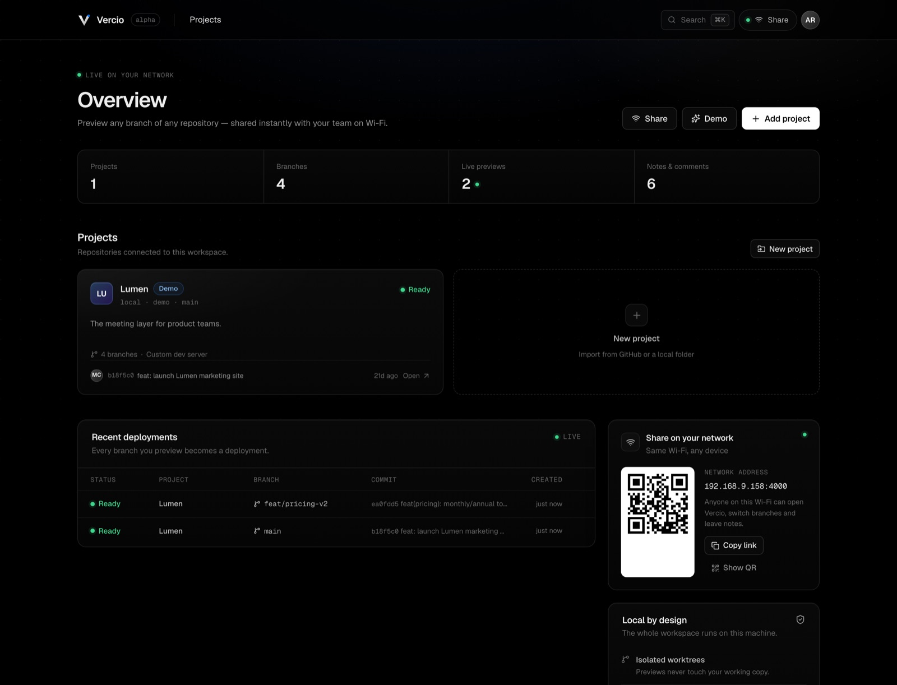

过去，Vercel 的「前端协作」是：绑定一个 GitHub 仓库，就能在网页上预览最新分支的前端。
今天，Vercio 把这件事搬回本地：仓库就在你的电脑上，Vercio 用 Git worktree 把每个分支检出到隔离目录并启动预览，你在网页上点击分支就能看到变化。同一 Wi-Fi 下的同事扫码即可打开同一个工作台，还能一起写产品描述、笔记和分支评论。

```text
浏览器 / 手机 / 同事的电脑 (同一 Wi-Fi)
        │  http://192.168.x.x:4000
        ▼
┌──────────────────────────────────────────────┐
│ Vercio server                                │
│  · React 工作台（Dashboard / Previews / ...）│
│  · REST API + SSE 实时状态                    │
│  · /preview/dpl_xxx/ ── 302 ──▶ :41xx        │
└──────────────┬───────────────────────────────┘
               │ 每个分支一个隔离 worktree
               ▼
   .vercio/worktrees/<project>/<branch>-<sha>
               │
      ┌────────┴─────────┐
      ▼                  ▼
  dev server         static server
  (Next/Vite/...)    (预构建静态文件)
  127.0.0.1:41xx     127.0.0.1:41xx
```


## 功能

- **分支即预览**：指定 GitHub 仓库或本地 Git 仓库，任意分支都能一键启动预览。首次启动后再次点击是秒开的，因为 worktree、依赖和部署记录都会被复用。
- **并排对比**：选择任意两个分支左右对比，直接看前端差异；同时显示相对 production 分支的改动文件与增删行数。
- **局域网分享**：默认绑定 `0.0.0.0:4000`，扫码或复制链接即可让同一 Wi-Fi 的同事打开工作台。每个预览都有稳定的 `/preview/<id>` URL，可单独分享。
- **产品空间**：每个项目都有可编辑的 Product brief（Markdown）、README 预览、项目笔记（Markdown、标签、置顶、自动保存、可关联分支）和分支讨论区。
- **框架自动识别**：Next.js、Vite、Astro、SvelteKit、Remix、Nuxt、CRA、Vue CLI、Gatsby、自定义 dev server、纯静态站点，自动生成正确的端口与 host 参数。
- **依赖缓存**：按 `package.json + lockfile` 指纹缓存 `node_modules`；如果本地工作副本已经装好了依赖，会直接复用软链，避免重复安装。
- **本地文件夹选择器**：添加本地项目时可以直接浏览这台机器上的目录，自动标记 Git 仓库并填入路径，不用手动输入长路径。
- **过程可视**：准备 worktree、安装依赖、启动 dev server 的每一步都有实时日志与状态；失败时可以看完整日志，一键重试。
- **本地优先**：代码、分支、产品描述、笔记、评论全部存在本机 `.vercio/` 目录里，不上传任何东西。
- **中英双语界面**：默认跟随浏览器语言，也可用右上角 **EN / 中文** 随时切换并记住偏好；仓库内容、笔记等数据保持原文，不参与界面翻译。
- **白天 / 黑夜主题**：首次访问跟随系统外观，右上角太阳/月亮按钮（或本地资料弹窗）一键切换并记住偏好。界面采用**全屏宽度**布局，大屏上可以并排查看更宽的分支预览与部署列表。

## 截图

| 分支预览 | 并排对比 |
| --- | --- |
| 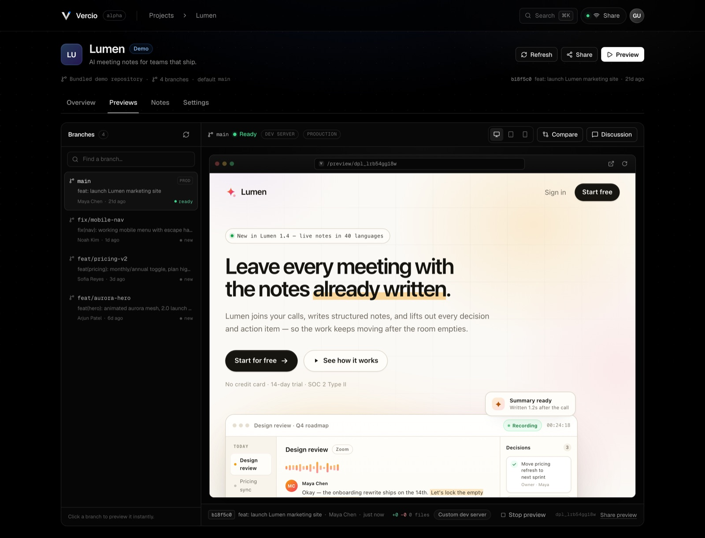 | 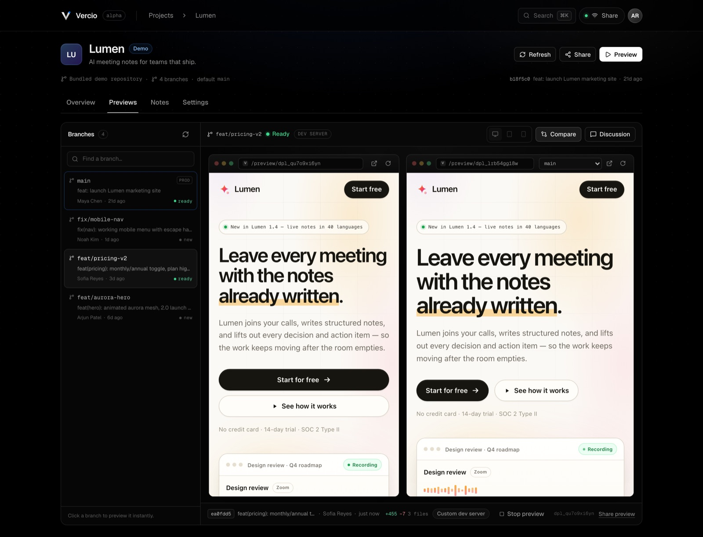 |

| 分支讨论 | 产品笔记 |
| --- | --- |
| 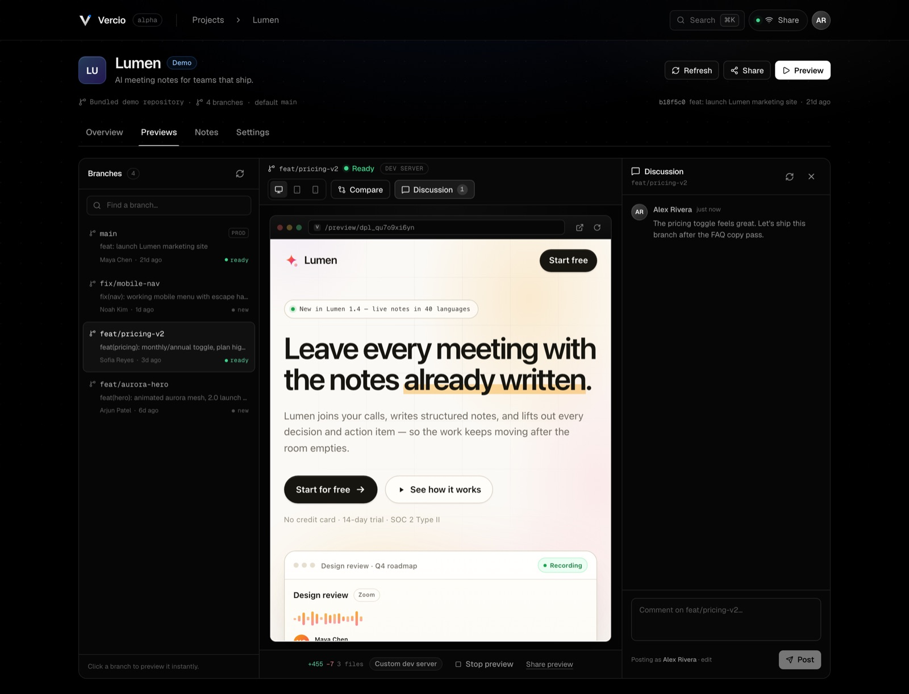 | 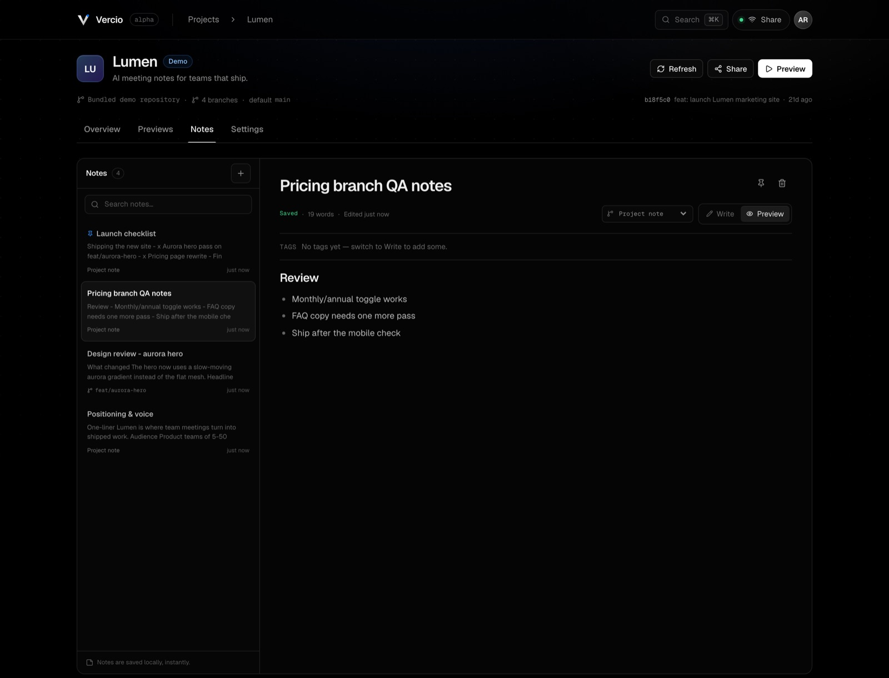 |

| 项目概览（Product brief + README） | 局域网分享（二维码） |
| --- | --- |
| 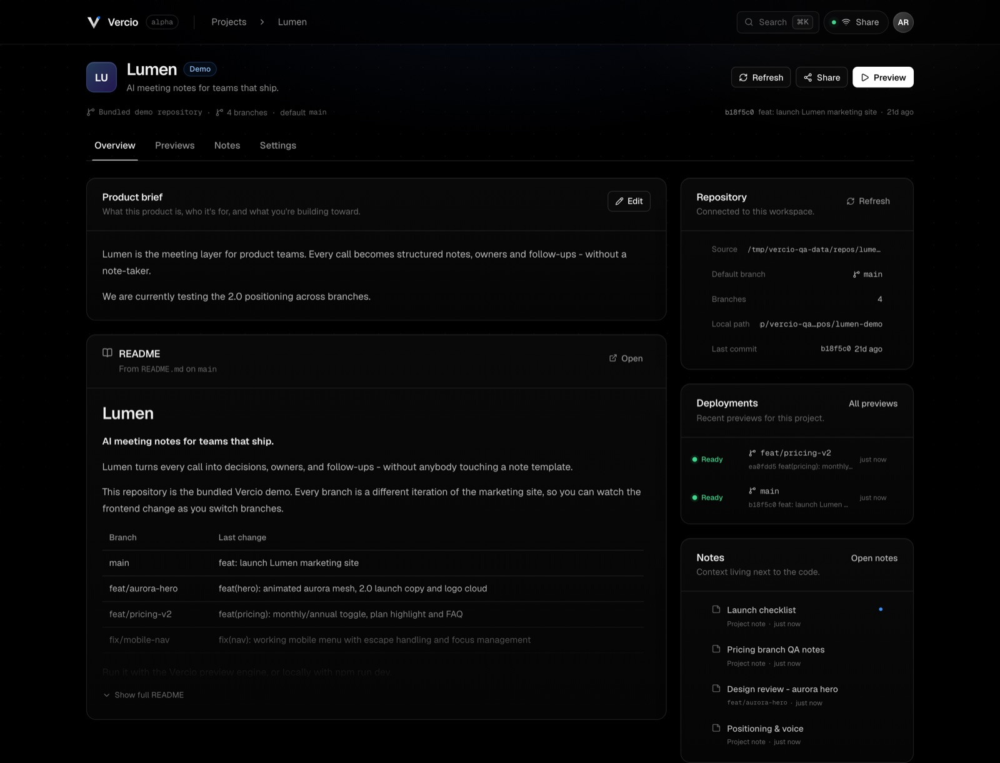 | 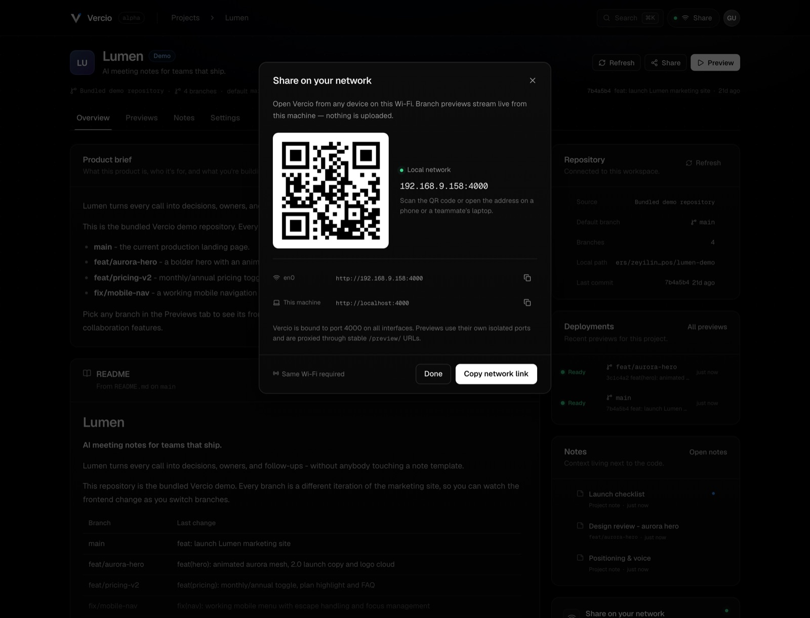 |

| 中文界面（黑夜） | English UI (dark) |
| --- | --- |
| 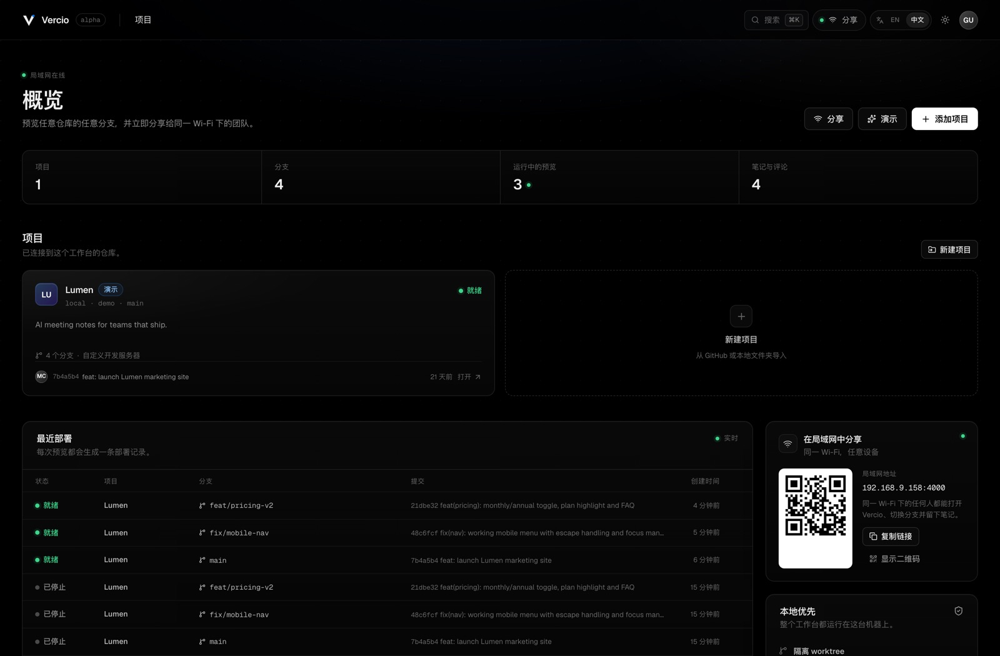 |  |

| 白天模式 · 工作台 | 白天模式 · 分支预览 |
| --- | --- |
| 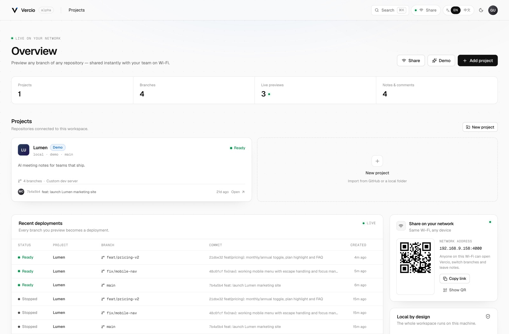 | 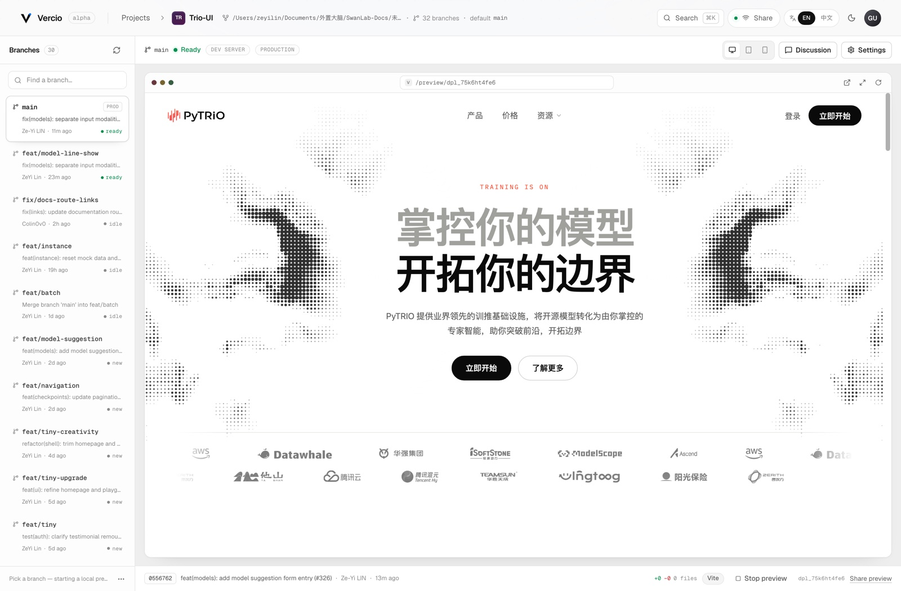 |

| 首次打开 / 引导 |
| --- |
| 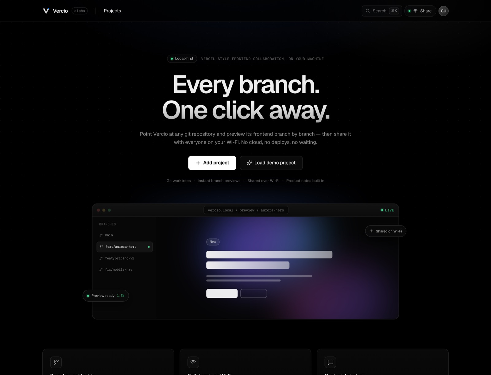 |

<p align="center">
  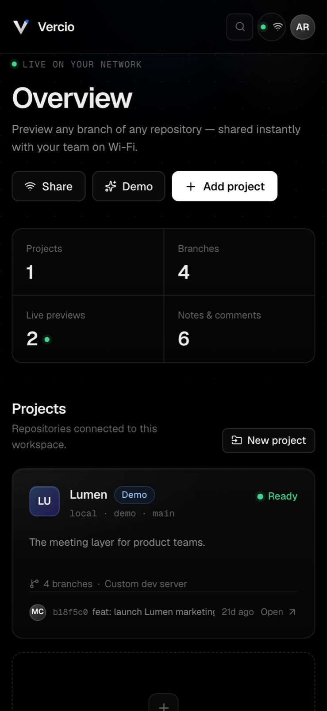
  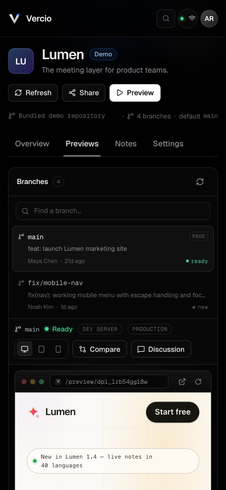
</p>

## 快速开始

前置条件：**Node.js `^20.19.0 || >=22.12.0`**、**Git**。支持 macOS / Linux（Windows 未验证）。

```bash
npm install

# 开发模式：Vite 前端（默认 5173）+ API (4000)
npm run dev

# 生产模式：构建前端并由 Node 服务统一托管
npm run build
npm start
```


打开 http://localhost:4000 ，然后（界面可随时用右上角 **EN / 中文** 切换，默认为浏览器语言）：

1. 点击 **Load demo project** 载入内置的 Lumen 演示仓库（4 个分支，可直接体验分支切换/对比/笔记/讨论）；或
2. 点击 **Add project**，输入 GitHub 仓库（`owner/repo` 或完整 URL）或本机仓库绝对路径。

局域网分享：点击右上角 **Share** 或 Dashboard 中的二维码。默认监听 `0.0.0.0:4000`，同一 Wi-Fi 的设备打开 `http://<你的局域网 IP>:4000` 即可。

其他入口：

```bash
npm run demo        # 直接在 .vercio/ 中准备好演示项目，不启动 UI
npm run start:open  # 启动并自动打开浏览器
npm test            # 后端集成测试
npm run typecheck   # TypeScript 检查
```


## 使用流程

1. **添加项目**：GitHub 仓库会 clone 到 `.vercio/repos/`；本地仓库直接引用原目录，不会改动你的工作区。
2. **Previews**：左侧分支列表点击即预览。首次会创建隔离 worktree、安装依赖并启动 dev server，过程有日志；再次点击同一分支通常直接复用。
3. **对比**：点击 **Compare**，右侧选择对比分支；两个分支各自运行在独立端口，互不干扰。
4. **讨论**：预览页右上角 **Discussion** 打开当前分支的讨论面板，评论与关联笔记会同步给所有访问者。
5. **产品描述 / 笔记**：Overview 中写 Product brief，Notes 中写产品笔记、评审记录、发布清单；全部 Markdown 渲染、自动保存。
6. **分享**：右上角 Share 显示二维码与局域网地址；预览页的 `/preview/<deployment-id>/` 链接也可以单独发人。

## 支持的框架

| 类型 | 识别方式 | 启动方式 |
| --- | --- | --- |
| Next.js | `next` 依赖 | `npm run dev -- -p PORT -H 0.0.0.0` |
| Vite（React/Vue/Svelte/Remix 等） | `vite` 依赖或 `vite.config.*` | `npm run dev -- --port PORT --host 0.0.0.0 --strictPort` |
| Astro | `astro` 依赖 | 同上，Vite 端口参数 |
| SvelteKit | `@sveltejs/kit` 依赖 | 同上，Vite 端口参数 |
| Nuxt | `nuxt` 依赖 | `npm run dev -- --port PORT --host 0.0.0.0` |
| Create React App | `react-scripts` 依赖 | `PORT` / `HOST` 环境变量 |
| Vue CLI | `@vue/cli-service` 依赖 | `PORT` 环境变量 |
| Gatsby | `gatsby` 依赖 | `gatsby develop -p PORT -H 0.0.0.0` |
| 自定义 dev server | `package.json` 有 `dev` / `start` 脚本 | 注入 `PORT` / `HOST` 环境变量，需自行读取 |
| 纯静态 | 存在 `index.html`（根目录或 dist/build/out/public 等） | Vercio 内置静态服务器，无需构建 |

包管理器根据 lockfile 自动识别：`pnpm-lock.yaml` / `yarn.lock` / `bun.lockb` / `package-lock.json`，否则用 npm。

> 自定义 dev server 请务必读取 `PORT`（或接受 `--port` 参数）并绑定 `0.0.0.0`，否则局域网与 Vercio 的端口探测无法工作。

## 工作原理

- **隔离 worktree**：每个 `(项目, 分支, commit)` 对应 `.vercio/worktrees/<projectId>/<branch>-<sha>` 的一个 `git worktree`。分支之间、分支与你的工作副本之间完全隔离，切换分支不会丢改动。
- **端口分配**：预览服务使用 `4100–4999` 的空闲端口并绑定 `0.0.0.0`；默认最多同时保留 8 个运行中的预览，超出时自动停止最旧的。
- **稳定预览 URL**：iframe 访问 `/preview/<deploymentId>/`，Vercio 302 到对应端口，因此绝对路径资源、Vite HMR、静态构建产物都能正常工作；在局域网设备上会自动使用当前主机名，生成的分享链接天然可用。
- **依赖缓存**：对 `package.json` + lockfile 做哈希，把 `node_modules` 缓存到 `.vercio/deps/<projectId>/<hash>/`，下一次有相同依赖的分支直接软链复用；如果启动项目的本地工作副本已安装且指纹一致，也会直接复用工作副本的 `node_modules`。
- **状态与日志**：部署状态通过 SSE 广播给所有打开的页面；准备/安装/启动日志写入内存与 `.vercio/logs/`，前端轮询显示。
- **本地持久化**：`.vercio/db.json` 原子写入，包含项目、部署记录、笔记、评论和设置。删除项目会清理对应 worktree、依赖缓存、笔记与评论（本地路径仓库不会被删除）。
- **演示项目**：内置 `examples/demo/`，按 manifest 生成一个真实的 4 分支 Git 仓库，并自带产品描述、笔记与评论示例。

## 配置

| 环境变量 | 默认值 | 说明 |
| --- | --- | --- |
| `VERCIO_PORT` / `PORT` | `4000` | Vercio 服务端口 |
| `VERCIO_HOST` | `0.0.0.0` | 监听地址（默认允许局域网访问） |
| `VERCIO_DATA_DIR` | `<repo>/.vercio` | 数据目录（数据库、仓库、worktree、缓存、日志） |
| `VERCIO_MAX_PREVIEWS` | `8` | 同时运行的最大预览数 |

CLI 参数：`node server/index.js --port 4001 --host 127.0.0.1 --data-dir ~/.vercio --open`。

## 数据目录结构

```text
.vercio/
├── db.json                 # 项目、部署、笔记、评论、设置
├── repos/                  # clone 的 GitHub 仓库 + 演示仓库
├── worktrees/<projectId>/  # 每个分支/commit 的隔离 worktree
├── deps/<projectId>/       # 依赖缓存（按 lockfile 指纹）
└── logs/                   # 预览构建日志
```


## API 速览

| 方法 | 路径 | 说明 |
| --- | --- | --- |
| GET | `/api/overview` | 工作台数据（项目、最近部署、统计） |
| GET | `/api/system` | 版本、局域网地址、二维码、设置 |
| GET | `/api/fs/browse?path=&showHidden=` | 目录浏览（只返回文件夹名、标记 Git 仓库） |
| POST | `/api/projects` | 从 GitHub URL / 本地路径添加项目 |
| POST | `/api/projects/demo` | 载入内置演示项目 |
| PATCH | `/api/projects/:id` | 更新名称、标语、描述、链接 |
| POST | `/api/projects/:id/refresh` | git fetch 并刷新分支元数据 |
| GET | `/api/projects/:id/branches` | 分支列表 + 每分支最新部署 |
| GET | `/api/projects/:id/changes?branch=` | 相对 production 分支的 diff 统计 |
| POST | `/api/projects/:id/deployments` | 为分支创建预览 `{ branch, mode }` |
| GET | `/api/deployments/:id/logs` | 预览日志（文本） |
| POST | `/api/deployments/:id/stop` | 停止预览 |
| GET/POST | `/api/projects/:id/notes` | 读取/新建笔记 |
| PATCH/DELETE | `/api/notes/:id` | 更新/删除笔记 |
| GET/POST | `/api/projects/:id/comments?branch=` | 分支讨论 |
| GET | `/api/events` | SSE 实时事件 |

## 项目结构

```text
vercio/
├── server/                 # 轻量 Node 服务（仅依赖 qrcode 生成二维码）
│   ├── index.js            # HTTP server / 启动 / 优雅退出
│   ├── routes.js           # REST API + /preview 重定向
│   └── lib/
│       ├── deployments.js  # worktree、依赖、进程、端口、日志
│       ├── projects.js     # 项目导入、GitHub clone、演示项目
│       ├── git.js          # git 命令封装
│       ├── browse.js       # 文件夹浏览（目录列表、Git 仓库标记）
│       ├── frameworks.js   # 框架检测与启动参数
│       ├── demo.js         # 演示仓库生成
│       ├── lan.js          # 局域网地址、Wi-Fi 名称、二维码
│       ├── store.js        # JSON 原子持久化
│       ├── events.js       # SSE 事件
│       └── http.js         # HTTP / 静态文件工具
├── web/                    # React + Vite + TypeScript 前端
│   └── src/
│       ├── pages/          # Dashboard / Previews / Overview / Notes / Settings
│       ├── components/     # 预览窗口、分支列表、讨论、Markdown、UI 组件
│       ├── context/        # App 级数据 + SSE
│       └── styles/         # Vercel 风格设计系统
├── examples/demo/          # 内置 Lumen 演示站点（4 分支快照 + 零依赖 dev server）
├── tests/                  # node:test 集成测试
├── scripts/                # dev / seed-demo
└── docs/images/            # README 截图
```


## 测试

```bash
npm test
```


覆盖：Git 分支解析与 diff、项目/笔记/评论 API、静态预览与重定向、自定义 dev server 预览的生命周期与停止、并发 worktree 隔离、文件夹浏览器（只返回目录、标记 Git 仓库、`~` 展开与错误处理）、演示项目生成与两条分支的实际内容差异。

本次交付验证还包括：真实 Vite 项目（`npm install` → dev server → 依赖缓存复用 → 局域网访问）、GitHub 仓库 clone 导入、React 界面端到端操作（载入演示、切换/对比分支、发评论、新建笔记自动保存、编辑 Product brief、添加/删除项目、文件夹选择、手机宽度布局）、白天/黑夜主题切换与刷新后持久化、1920px 全屏布局，以及无浏览器控制台错误。

## 多语言与主题

- 界面支持 **中文 / English**，首次访问按浏览器语言自动选择。
- 右上角的 **EN / 中文** 切换按钮即时生效，并把偏好保存在当前浏览器；本地资料弹窗里也能切换。
- 项目内容（仓库分支、README、产品描述、笔记、评论）按原文展示，不随界面语言改变。
- 新增语言只需在 [web/src/i18n/dictionary.ts](web/src/i18n/dictionary.ts) 中添加一份字典；TypeScript 会校验字典键完整性。
- 主题支持 **白天 / 黑夜**，首次访问跟随系统的 `prefers-color-scheme`，右上角太阳/月亮按钮或本地资料弹窗可切换；偏好保存在浏览器的 `vercio:theme` 中，主题样式集中在 [web/src/styles/theme-light.css](web/src/styles/theme-light.css)。
- 页面使用**全屏宽度布局**（只保留响应式边距），在 1920px 等大屏上会充分利用横向空间展示分支预览、对比窗口和部署列表。

## 安全与限制

- Vercio 面向**本机与可信局域网**，没有登录鉴权。请勿把 4000 端口直接暴露到公网；需要时用防火墙或反向代理加一层认证。
- 预览进程绑定 `0.0.0.0`，因此同一 Wi-Fi 的设备可以直连预览端口；分享链接中的 `/preview/<id>/` 会按访问者的主机名重定向。
- GitHub 私有仓库依赖本机 Git 凭据（SSH key / credential helper）；clone 在后台进行，失败可在项目页重试。
- 本地文件夹选择器会通过 API 列出运行 Vercio 的这台机器上的目录（只返回目录名，不返回文件内容）；任何能访问 Vercio 的局域网设备也能看到这些目录名，请只在可信网络中使用。
- 首次预览某个技术栈需要安装依赖，可能较慢；之后按 lockfile 指纹缓存。当前以 dev server 预览为主，不会执行生产构建（静态分支直接托管已有静态文件）。
- 已在 macOS + Node 25 上完整验证；Node 20.19+/22.12+ 理论兼容，Windows 路径与进程组处理尚未验证。

## Roadmap

- 局域网访问 PIN / 只读访客
- 预览截图与视觉 diff
- 分支级评论定位到具体预览区域
- 自定义域名 / 多仓库 workspace
- 一键把 production 分支标记为「已晋升」
- Windows 兼容与 npm 包分发

## License

[MIT](LICENSE)
